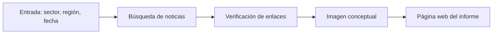
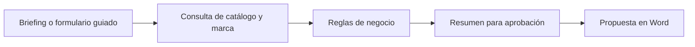
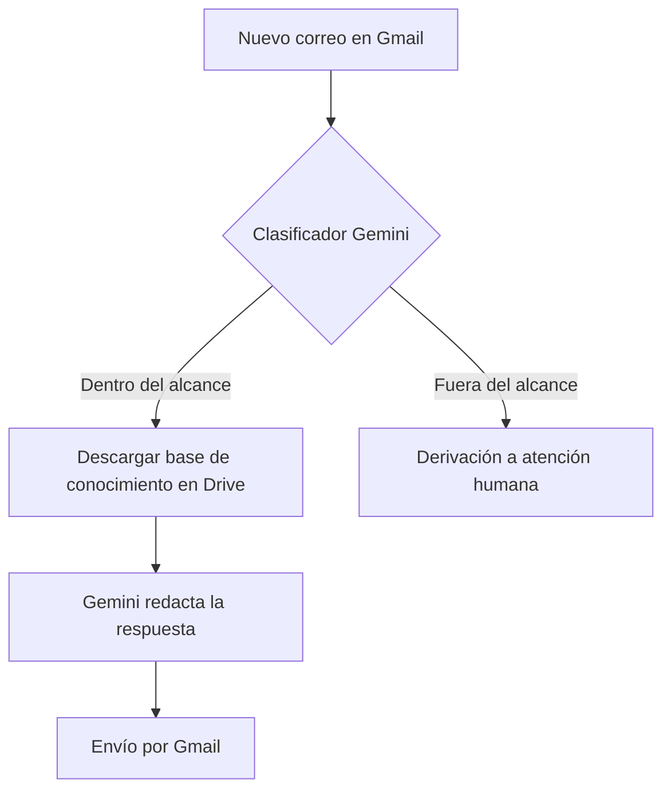
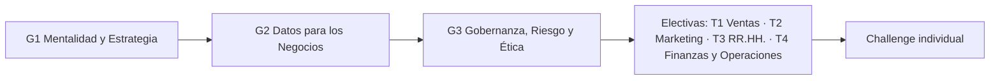

# ONE AI for Business · Portfolio de aprendizaje

**Maru Cepeda** · Business Operations | Data & Analytics · [[LinkedIn](https://www.linkedin.com/in/marucepeda/)]

Proyectos prácticos sin código (no-code) que documentan recorrido de **ONE AI for Business** | Oracle Next Education & Alura LATAM: desde agentes y pipelines de IA hasta automatización de procesos de negocio.

> Portfolio de aprendizaje independiente. No es un repositorio oficial de Oracle ni de Alura. Los tres primeros proyectos se construyeron siguiendo clases guiadas. Cada proyecto se documenta a nivel de diseño, resultado y aprendizaje.

---

## Proyectos de un vistazo

| # | Proyecto | Problema de negocio | Herramientas | Demo |
|---|----------|--------------------|--------------|------|
| 1 | [ARI News](#1-ari-news--inteligencia-de-mercado-con-un-pipeline-de-agentes) | Vigilancia semanal de noticias del sector | Google Opal | [Abrir app](https://opal.google/app/1lLKgqjmZM90UVGhPuxGbYtsn_A3GocnH) |
| 2 | [ARI Deal](#2-ari-deal--propuestas-comerciales-con-reglas-de-negocio) | Propuestas comerciales lentas e inconsistentes | ChatGPT Work | Proyecto privado |
| 3 | [ARI Flow](#3-ari-flow--triaje-y-respuesta-automática-de-correos) | Atención repetitiva de consultas por email | Make · Gmail · Drive · Gemini | [Ver escenario](https://us2.make.com/public/shared-scenario/RcuIxvi6Zzh/ari-flow) |
| 4 | [Challenge individual](#fase-2--business-ai-builder) | [Por definir] | [Por definir] | Pendiente |

---

## Qué muestra este portfolio

- Diseñar **pipelines de agentes** donde cada etapa tiene una misión específica, en lugar de usar la IA como una caja de texto.
- Distinguir **chatbot, copiloto, agente con reglas de negocio y pipeline multiagente**, y elegir cuál corresponde a cada problema.
- Dar **contexto propio** a la IA (documentos de la empresa) para reducir respuestas genéricas y alucinaciones.
- **Automatizar con criterio:** qué se delega a la IA y qué se deriva a una persona.
- Documentar con honestidad **qué funciona, qué falló y qué falta verificar**.

---

## 1. ARI News · Inteligencia de mercado con un pipeline de agentes

**Problema.** Mantenerse al día con noticias estratégicas de un sector y una región exige tiempo y suele producir resúmenes inconsistentes o con fuentes dudosas.

**Solución.** Un pipeline visual que recibe sector, región y fecha, busca noticias recientes y entrega una página web de resumen lista para compartir con un equipo.

**Demo.** [Abrir ARI News en Google Opal](https://opal.google/app/1lLKgqjmZM90UVGhPuxGbYtsn_A3GocnH)

> **Disponibilidad:** Google anunció que Opal deja de funcionar el 17 de noviembre de 2026 y que sus flujos pasan a ser skills de Gemini ([FAQ oficial](https://developers.google.com/opal/faq)). Después de esa fecha el enlace dejará de ejecutarse.

**Aprendizajes.** El problema de las **alucinaciones de enlaces** (URLs inventadas) y por qué toda fuente generada por IA debe verificarse antes de usarla.

---

## 2. ARI Deal · Propuestas comerciales con reglas de negocio

**Problema.** Las propuestas comerciales consumen horas, se desvían del formato de marca y pueden incluir valores incorrectos.

**Solución.** Un agente con proceso, memoria y reglas de negocio que recibe los datos de una oportunidad y prepara una propuesta en Word con precios de catálogo y formato de marca, para revisión humana antes de enviarse.

**Conceptos aplicados.** Diferencia entre chatbot, copiloto y agente · contexto persistente · documentos de referencia como memoria del agente · reglas de negocio explícitas · revisión humana antes de generar el documento · conversión del flujo en una skill reutilizable.

**Limitaciones.** Depende de la calidad de los documentos de referencia; toda propuesta requiere revisión antes de salir.

---

## 3. ARI Flow · Triaje y respuesta automática de correos

**Problema.** Consultas repetitivas que ocupan tiempo de atención y que, en su mayoría, ya están respondidas en la documentación.

**Solución.** Un flujo que monitorea una casilla, clasifica cada correo, responde con apoyo de un documento de conocimiento si está dentro del alcance y deriva el resto a una persona.

**Demo.** [Ver el escenario en Make](https://us2.make.com/public/shared-scenario/RcuIxvi6Zzh/ari-flow)

**Diseño destacado.** La base de conocimiento vive en Drive: quien actualiza el documento actualiza al agente, sin tocar el flujo.

**Riesgos y controles.** Un agente que envía correos sin revisión puede responder o clasificar mal. Controles a considerar: revisión previa, límite de alcance, registro de respuestas, pruebas de clasificación.

---

## Fase 2 · Business AI Builder

La segunda etapa del programa organiza el aprendizaje en **7 formaciones** y un **challenge individual obligatorio**.

### Resumen

| Código | Formación | Tipo | Cursos |
|--------|-----------|------|--------|
| G1 | Mentalidad y Estrategia | General | 1. Alfabetización en IA: Competencias esenciales y dominio crítico (6 h) 2. Entienda cómo aplicar el Canvas AI en la práctica (1 h) 3. IA en el trabajo: Productividad con asistentes y agentes (6 h) |
| G2 | Datos para los Negocios | General | 1. Toma de decisiones con IA: Optimizando estrategias con datos (10 h) 2. Liderazgo en la era de la IA: Fundamentos y visión estratégica (10 h) 3. Trabajando con datos: Fundamentos del análisis de datos (6 h) |
| G3 | Gobernanza, Riesgo y Ética | General | 1. Gobernanza de Inteligencia Artificial: Fundamentos, riesgos y buenas prácticas (7 h) 2. Ética en Inteligencia Artificial: Mitigando sesgos y garantizando transparencia (6 h) |
| T1 | IA para Ventas y Comercial | Electiva | 1. Inteligencia Artificial: Personalice estrategias de ventas con ChatGPT (6 h) 2. E-mail marketing: Automatización y workflows con IA (6 h) 3. CRM, automatizaciones e IA: Automatice procesos de ventas con inteligencia artificial (6 h) |
| T2 | IA para Marketing y Contenido | Electiva | 1. Producción de contenido con IA: Cree asistentes en Gemini para escalar su comunicación multicanal (14 h) 2. Inteligencia Artificial: Gestión de redes sociales (8 h) 3. Redes Sociales: Construyendo un agente GPT para su negocio (8 h) |
| T3 | IA para RR.HH. | Electiva | 1. RR.HH. estratégico: Optimizando procesos con IA (12 h) 2. Inteligencia Artificial en RRHH: Creando Agentes con ChatGPT (8 h) 3. People Analytics: De la recolección de datos a la IA aplicada en RR.HH. (8 h) |
| T4 | IA para Finanzas y Operaciones | Electiva | 1. Análisis financiero eficiente: automatiza Excel con Power Query y Power Pivot (8 h) 2. Claude para Análisis de Datos: Prompts, integraciones y automatizaciones (8 h) 3. Gestión de Procesos: Mapeo y automatización con Lean y RPA (8 h) 4. Make: Automatizando respuestas de clientes (1 h) |

### Avance

- [x] G1 · Mentalidad y Estrategia
- [x] G2 · Datos para los Negocios
- [x] G3 · Gobernanza, Riesgo y Ética
- [ ] T1 · IA para Ventas y Comercial
- [ ] T2 · IA para Marketing y Contenido
- [ ] T3 · IA para RR.HH.
- [ ] T4 · IA para Finanzas y Operaciones
- [ ] Challenge individual

### Challenge individual

Es el único contenido obligatorio de la fase. Se documentará aquí cuando estén publicadas las bases oficiales: objetivo, criterios de entrega y entregables.

---

## Sobre este repositorio

Cada proyecto documenta únicamente trabajo realizado, con sus limitaciones. Material del curso no incluido por respeto a su autoría.

Parte del recorrido [Oracle Next Education (ONE)](https://www.oracle.com/latam/education/oracle-next-education/).
